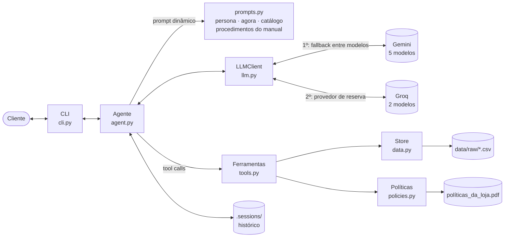

# 🎸 Empório da Música — Agente de Atendimento

Protótipo de um agente de atendimento por texto para a **Empório da Música**, loja de instrumentos musicais de Campo Grande/MS.
O agente — **Clave** — responde dúvidas sobre catálogo, preços, pagamento, pedidos e políticas da loja, consultando os dados
e o manual oficial por meio de ferramentas (function calling), e encaminha para a equipe humana o que precisa de ação.

```
Você: Quanto custa o Takamine GD20?
  ⚙ detalhes_produto({"produto": "Takamine GD20"})
  ⚙ calcular_pagamento({"produto_id": 95})
Clave: O Takamine GD20 Dreadnought Natural está disponível por R$ 2.199,00.
       No PIX sai por R$ 2.089,05 (5% off) ou em até 12x de R$ 183,25 sem juros no cartão. [...]
```

**Sumário:** [Como rodar](#como-rodar) · [Exemplos](#exemplos-de-conversa) · [Arquitetura](#arquitetura) ·
[Decisões técnicas](#decisões-técnicas) · [Qualidade dos dados](#tratamento-e-qualidade-dos-dados) ·
[Suposições](#suposições) · [Limitações](#limitações-e-próximos-passos) · [Uso de IA](#uso-de-assistentes-de-código)

---

## Como rodar

**Pré-requisitos:** Python 3.11+ e uma chave de API gratuita do Google Gemini
(opcional: uma chave gratuita do Groq como provedor de reserva).

1. **Crie a chave** em [aistudio.google.com](https://aistudio.google.com) → *Get API key* → *Create API key*
   (plano gratuito, sem cartão). *Opcional:* crie também uma em [console.groq.com](https://console.groq.com/keys)
   e cole em `LLM_FALLBACK_API_KEY` — o agente passa a usá-la quando a cota do Gemini acaba.

2. **Instale e configure:**

   ```bash
   git clone https://github.com/daianesmendes/emporio-agente.git
   cd emporio-agente
   cp .env.example .env        # depois cole a chave em LLM_API_KEY
   ```

3. **Instale as dependências** — com [uv](https://docs.astral.sh/uv/) (recomendado):

   ```bash
   uv sync
   uv run emporio --debug
   ```

   ou com pip:

   ```bash
   python -m venv .venv && source .venv/bin/activate
   pip install -e .
   emporio --debug
   ```

### Comandos

| Comando | O que faz |
|---|---|
| `emporio` | Conversa interativa no terminal (`/novo` reinicia, `/sair` encerra) |
| `emporio --debug` | Mostra quais ferramentas o agente chamou e qual modelo respondeu |
| `emporio --sessao maria` | Salva o histórico e retoma a conversa depois |
| `emporio --roteiro examples/roteiros/01_catalogo_e_pagamento.txt -o saida.md` | Roda uma conversa pré-escrita e grava a transcrição |
| `pytest` | 29 testes (ferramentas, dados, loop do agente e fallback) — **não gastam cota de API** |

### Configuração (`.env`)

| Variável | Padrão | Para que serve |
|---|---|---|
| `LLM_BASE_URL` | endpoint OpenAI-compatível do Gemini | Troque para usar Groq, OpenAI ou Ollama (exemplos no `.env.example`) |
| `LLM_API_KEY` | — | Chave do provedor |
| `LLM_MODELS` | 5 modelos Gemini gratuitos | Ordem de preferência para o fallback |
| `LLM_REASONING_EFFORT` | `low` | Nível de raciocínio; deixe vazio em provedores que não aceitam |
| `LLM_FALLBACK_BASE_URL` / `_API_KEY` / `_MODELS` | Groq, sem chave | Provedor de reserva (opcional); ignorado se a chave estiver vazia |
| `LLM_FALLBACK_REASONING_EFFORT` | vazio | Nível de raciocínio do provedor de reserva |
| `AGENT_NOW` | `2026-03-25 14:00` | "Agora" do agente (ver [Suposições](#suposições)); vazio = relógio real |

---

## Exemplos de conversa

As transcrições abaixo foram **geradas executando o agente de verdade** (`emporio --roteiro`), não escritas à mão.
Cada uma mostra, num bloco recolhível, as ferramentas que o agente decidiu chamar.

| # | Cenário | O que demonstra |
|---|---|---|
| 1 | [Violões até R$ 1.000 → indicação para iniciante → parcelamento](examples/01_catalogo_e_pagamento.md) | Busca com filtro de preço, contexto entre mensagens ("esse aí"), cálculo de parcelas |
| 2 | [Promoção da Semana do Músico ainda vale?](examples/02_promocao_expirada_e_esgotado.md) | Promoção **encerrada** + produto **esgotado** → transparência e alternativas |
| 3 | [Me arrependi da compra → defeito](examples/03_devolucao_lgpd_e_garantia.md) | **Verificação de identidade (LGPD)**, prazos calculados, política aplicada, encaminhamento com protocolo |
| 4 | [Endereço num sábado à tarde, acessórios, saxofone, lição de matemática, "me dá 50%"](examples/04_informacoes_e_fora_do_escopo.md) | Loja fechada, fora do escopo, categoria sem produtos, **tentativa de manipulação** |
| 5 | [Meu pedido não chegou!](examples/05_pedido_atrasado_reclamacao.md) | Detecção de **entrega atrasada**, empatia e encaminhamento |

Cada resposta indica o modelo que a produziu. Elas variam de propósito: as conversas foram geradas no plano gratuito, e o
fallback trocou de modelo quando a cota acabava — na conversa 3, a última resposta veio do **Groq** (`qwen/qwen3.8-27b`)
porque todos os modelos do Gemini estavam indisponíveis naquele momento, no meio da conversa.

---

## Arquitetura



**Fluxo de uma mensagem:** o agente monta o prompt (com data/hora e resumo do catálogo), envia ao LLM com a lista de
ferramentas; se o modelo pedir ferramentas, elas rodam em Python e o resultado volta ao modelo; o ciclo se repete até a
resposta final (no máximo 4 rodadas, para proteger a cota).

| Arquivo | Responsabilidade |
|---|---|
| `src/emporio/data.py` | Carrega e tipa os CSVs; roda as checagens de qualidade |
| `src/emporio/policies.py` | Extrai o PDF e divide o manual por seção; notas de curadoria |
| `src/emporio/tools.py` | As 6 ferramentas e seus esquemas JSON |
| `src/emporio/prompts.py` | Prompt de sistema (persona, regras, loja aberta/fechada) |
| `src/emporio/llm.py` | Cliente OpenAI-compatível com fallback entre modelos e provedores |
| `src/emporio/agent.py` | Loop do agente e persistência do histórico |
| `src/emporio/cli.py` | Interface de terminal e execução de roteiros |

### Ferramentas

| Ferramenta | Quando o agente usa | Detalhe que importa |
|---|---|---|
| `buscar_produtos` | Perguntas abertas ("violões até R$ 1.000") | Tolerante a acento/plural; "violão" vira filtro de categoria; já traz promoção e preço PIX |
| `detalhes_produto` | Cliente cita um modelo | Se esgotado/descontinuado, sugere 3 alternativas de preço próximo; ambíguo → pede para escolher |
| `consultar_pedido` | Status, rastreio, devolução | **Exige e-mail ou telefone do dono**; calcula prazos de arrependimento, troca e garantia |
| `calcular_pagamento` | Parcelas, PIX | Aplica parcela mínima por faixa e a regra "PIX não acumula com promoção" |
| `consultar_politicas` | Regras da loja | Devolve a seção inteira do manual + nota de curadoria |
| `encaminhar_para_humano` | Reclamação, devolução a efetivar, garantia, pedido de atendente | Gera protocolo e informa o prazo de 24h úteis; com o protocolo, complementa um caso já aberto |

---

## Decisões técnicas

### 1. Abordagem: function calling, com o manual roteado por seção

O problema tem duas naturezas de informação, e cada uma pede um mecanismo:

- **Dados estruturados** (preço, estoque, pedido) → **ferramentas em Python**. O LLM decide *qual* consulta fazer;
  o código faz a consulta e as contas. Assim o modelo nunca "lembra" um preço nem erra uma conta de parcelamento —
  o próprio manual diz que informação errada "pode configurar propaganda enganosa".
- **Texto normativo** (políticas) → **uma ferramenta que devolve a seção do manual pelo tópico** (`trocas_e_devolucoes`,
  `garantia`, ...). O modelo escolhe o tópico a partir de um `enum`.

**Por que não RAG vetorial?** O manual tem ~11 mil caracteres e 10 seções bem delimitadas. Chunking + embeddings
acrescentariam um ponto de falha (um chunk pode cortar a tabela de parcelamento ao meio, ou a busca pode trazer a seção
errada) sem ganho real. O roteamento por seção é determinístico, auditável e não gasta chamadas de embedding.
**Quando eu mudaria:** com dezenas de documentos ou um manual grande demais para caber numa seção por vez — aí entraria
busca híbrida (BM25 + embeddings) com reranking.

**Por que não um agente de SQL?** Gerar SQL livre a partir da conversa abriria espaço para consultas erradas e, pior,
para vazar dados de outros clientes. Ferramentas com parâmetros fechados garantem a regra de LGPD em código, não no prompt.

### 2. Sem framework de agentes

O loop do agente tem ~60 linhas (`agent.py`). Escrevê-lo diretamente deixa cada decisão visível (teto de rodadas,
corte do histórico, tratamento de erro) e evita dependências pesadas. LangChain/LangGraph passariam a valer a pena com
fluxos de várias etapas com estado (ex.: abrir uma troca de ponta a ponta), múltiplos agentes ou necessidade de checkpoints.

### 3. Modelo e provedor: Gemini gratuito, mas sem amarrar o código a ele

- **Provedor-agnóstico:** o código usa o SDK da OpenAI, cuja API de chat é aceita por Gemini, Groq, OpenAI e Ollama.
  Trocar de provedor é mudar três linhas do `.env`.
- **Gemini no plano gratuito** como padrão porque qualquer avaliador cria uma chave em minutos, sem cartão,
  e o modelo faz function calling bem.
- **Fallback entre modelos:** no plano gratuito cada modelo tem cota própria (5 req/min, 20 req/dia nos Flash;
  15/min e 50/dia nos Flash Lite). Quando um modelo devolve 429 (cota), 503 (sobrecarga) ou estoura 30 s, ele entra em
  espera por 60 s e o próximo assume — somando ~160 requisições/dia sem o cliente perceber.
- **Ordem dos modelos decidida por medição, não pelo número da versão.** Medi a latência de cada um no plano gratuito:

  | Modelo | Resultado da medição |
  |---|---|
  | gemini-3.8-flash (mais novo) | 503 — sobrecarregado; na primeira tentativa, a resposta levou mais de 2 min |
  | **gemini-3-flash-preview** | **1,8 s** |
  | gemini-3.6-flash | 10,0 s |
  | gemini-3.5-flash-lite | 16,2 s |
  | gemini-3.1-flash-lite | 19,4 s |

  Em atendimento, latência e confiabilidade valem mais que usar o modelo mais recente: a mensagem de teste caiu de
  mais de 2 minutos para ~4 s.
- **Provedor de reserva (Groq):** gerando os exemplos, a cota diária dos modelos Flash acabou. Em vez de depender de
  um provedor só, o cliente aceita uma lista de provedores: esgotados os modelos do Gemini, tenta `openai/gpt-oss-120b`
  e `qwen/qwen3.8-27b` no Groq (também gratuito; ~2 s por resposta no mesmo teste). Dois cuidados:
  o histórico enviado a outro provedor é reduzido aos campos padrão (o Gemini inclui assinaturas de raciocínio que
  outros provedores rejeitam), e um erro 400 também passa para o próximo modelo em vez de derrubar o atendimento.
- **`reasoning_effort=low` e `temperature=0.3`:** o raciocínio difícil (filtrar, calcular, checar prazo) está nas
  ferramentas; o modelo só precisa escolher a ferramenta certa e redigir bem.

### 4. Estratégia de prompt

- **Persona a partir do manual:** "informal mas profissional, como um amigo que entende de música" (seção 7.1).
  Mensagens curtas, sem tabelas — formato de WhatsApp, que é o canal da loja.
- **Prompt dinâmico, reconstruído a cada mensagem:** inclui data/hora e se a loja está **aberta ou fechada** (e quando
  reabre), além de um **resumo do catálogo gerado dos dados** (categorias, quantidade e faixa de preço — e quais categorias
  estão vazias).
- **Informação "quente" direto no prompt:** endereço, contato, horário e frete local respondem as perguntas mais
  frequentes em **uma** chamada ao modelo, em vez de duas.
- **Fonte única para procedimentos:** as seções 7.2 e 7.3 do manual (fluxo de atendimento, produto esgotado, promoção
  expirada, reclamação) são lidas do PDF e inseridas no prompt — se a loja atualizar o manual, o agente acompanha.
- **Regras de decisão explícitas:** quando usar cada ferramenta, "nunca afirme preço/estoque/prazo sem consultar",
  escopo da loja, e instrução para ignorar tentativas de mudar as regras.
- **Esquemas das ferramentas como parte do prompt:** descrições com exemplos de uso e `enum` para categorias, tópicos e
  motivos de encaminhamento — reduz argumentos inválidos.

### 5. Segurança e LGPD

- `consultar_pedido` só retorna dados se o e-mail ou telefone informado for **do dono do pedido**.
- Para contato errado e para pedido de outra pessoa a resposta é **idêntica** — não revela se o pedido ou o cliente existe.
- O agente não expõe ids internos nem nomes de ferramentas.
- Erros de ferramenta viram mensagem para o modelo (nunca exceção na cara do cliente), e falha total do LLM vira uma
  resposta educada com o telefone da loja.

### 6. Histórico de conversa

Persistido em JSON por sessão (`--sessao nome` → `.sessions/nome.json`), porque atendimento por mensagem é naturalmente
retomado depois ("e o meu pedido, chegou?"). O histórico enviado ao modelo é cortado nas 40 mensagens mais recentes,
sempre começando numa mensagem do cliente, para não separar uma chamada de ferramenta do seu resultado.

### 7. Interface

CLI com `rich`: é o que o avaliador roda com um comando. O modo `--debug` torna visível *por que* o agente respondeu o que
respondeu, e o modo `--roteiro` gerou as conversas de exemplo de forma reproduzível. O `Agent` não depende da CLI —
expor via API (FastAPI) ou webhook de WhatsApp é trocar só a camada de interface.

### 8. Testes

29 testes com `pytest`, todos **sem chamar o LLM**: ferramentas (cada armadilha dos dados vira um teste), divisão do manual,
loop do agente com um LLM simulado (chamada de ferramenta → resposta, teto de rodadas, persistência) e o fallback de
modelos e de provedores. Isso permitiu iterar rápido sem gastar a cota diária.

### 9. Validação: revisando as conversas e corrigindo pela estrutura

Os testes garantem as ferramentas, mas não o que o modelo **diz**. Então cada conversa de exemplo foi conferida número a
número contra os dados e o manual. A primeira rodada encontrou quatro alucinações:

| O que o modelo fez | Por que é grave | Correção |
|---|---|---|
| Ofereceu "10x de R$ 79,90" sem chamar ferramenta | Abaixo da parcela mínima de R$ 100 — o manual chama isso de propaganda enganosa | **Estrutural:** todo produto devolvido já traz `parcelamento_maximo` calculado em Python (+ teste de regressão) |
| Exigiu "nota fiscal" para devolução | Regra que não existe no manual | Prompt: regras só depois de `consultar_politicas`, sem acrescentar exigências |
| Disse que um modelo é "um dos mais recomendados por professores no mundo" | Afirmação sem fonte | Prompt: sobre produto, só o que veio das ferramentas |
| Disse "já atualizei seu contato" sem ter chamado ferramenta | Ação inventada | **Estrutural:** `encaminhar_para_humano` aceita protocolo para complementar o caso; prompt proíbe declarar ação não executada |

A preferência foi por correções **estruturais** (dar ao modelo o dado pronto, ou uma ferramenta que faça a ação) em vez
de só acrescentar proibições no prompt: o modelo erra menos quando não precisa calcular nem improvisar. As conversas
afetadas foram regeradas e conferidas de novo.

---

## Tratamento e qualidade dos dados

Os arquivos originais ficam intocados em `data/raw/` (só os nomes foram simplificados). Toda limpeza acontece em código,
e o `Store` roda **checagens automáticas** ao carregar — que encontraram 14 problemas:

| Problema encontrado | Ocorrências | Decisão |
|---|---|---|
| Descrição cita marca diferente do nome (ex.: "Music Man Bass 1X" descrito como "Fender Jazz Bass") | 6 produtos | O agente usa nome, preço e especificações e **não repete a descrição** |
| Categorias sem nenhum produto (Sopro Madeiras, Sopro Metais, Cordas Orquestrais) | 3 | A busca avisa "categoria sem produtos" e o agente não inventa modelos |
| Total do pedido ≠ soma dos itens ao preço atual (pedidos 3 e 20) | 2 | Informa o total registrado no pedido (o preço pode ter mudado desde a compra) |
| Produto `coming_soon` presente em pedidos, um deles já entregue (pedidos 3 e 14) | 2 | Mantido; registrado como inconsistência do cadastro |
| Produto ativo com estoque zero (Giannini GF-3D) | 1 | Tratado como esgotado, com alternativas (seção 7.3 do manual) |

**Manual de políticas:** a extração simples do PDF devolvia uma palavra por linha e destruía as tabelas; o modo *layout*
do `pypdf` preserva a estrutura. O texto é dividido pelas seções numeradas — aceitando um número como título só se for o
próximo da sequência, porque a lista "1. Saudação, 2. Entendimento..." da seção 7.2 estava sendo confundida com os títulos.

**Contradições do manual** ficam em notas de curadoria explícitas (`CURATION_NOTES` em `policies.py`), anexadas à seção:

| Contradição | Decisão |
|---|---|
| Telefone/WhatsApp (67) 3341-4444 (capa e Dados da Empresa) × (67) 3321-4500 (só na seção 7) | Informar 3341-4444, que aparece em duas fontes |
| E-mail com acento ("empóriodamusica") × sem acento | Sem acento — domínio com acento é erro de digitação |
| Crédito com "parcela mínima R$ 100" na tabela × mínimos por faixa na seção 3.1 | A seção 3.1, mais específica, prevalece |
| "Mais de 300 instrumentos" × 65 no sistema | Só existe o que está no sistema |
| Defeito após 30 dias: "acionar o fabricante" (4.2) × garantia legal de 90 dias (8.1) | Até 30 dias da compra, troca na loja; até 90 dias do recebimento, garantia legal com a loja; depois, fabricante com intermediação |

---

## Suposições

- **Data de referência:** os pedidos vão até março/2026. Para que prazos de devolução e status sejam coerentes e os
  exemplos reproduzíveis, o agente usa `AGENT_NOW=2026-03-25 14:00` (configurável; vazio = relógio real).
- **Data de recebimento:** o sistema não guarda quando o cliente recebeu o pedido; uso a **previsão de entrega** como
  referência para os prazos de arrependimento (7 dias) e garantia legal (90 dias), e o agente avisa disso.
- **Parcelamento "até 3x sem valor mínimo (exceto abaixo de R$ 50)"** foi interpretado como parcela mínima de R$ 50.
- **Todas as compras do sistema são tratadas como online** (o direito de arrependimento vale para compras online).
- **Feriados** não estão no manual nem nos dados; o cálculo de "loja aberta" considera só os dias da semana.
- **Identificação do cliente:** num canal real de WhatsApp o telefone já viria do próprio canal; no protótipo o cliente
  informa e-mail ou telefone.
- **Lojas parceiras:** o manual sugere indicá-las, mas não há nenhuma cadastrada, então o agente não cita nomes.

---

## Limitações e próximos passos

**Limitações conhecidas**

- **Plano gratuito do Gemini:** cota de 20–50 requisições/dia por modelo e latência variável (de ~2 s a 20 s; o modelo
  mais novo chegou a ficar indisponível). O fallback entre modelos e para o Groq mitiga, mas não elimina.
- **Qualidade varia com o modelo que responde:** quando o fallback cai num modelo menor, o tom e o nível de detalhe
  mudam. As regras críticas (preço, parcelas, prazos, LGPD) estão em código e não dependem do modelo.
- **A revisão das conversas foi manual:** cobre os 5 cenários, não uma bateria ampla (ver "Com mais tempo").
- **Busca por palavra-chave:** entende acentos, plural, sinônimos de categoria e erros leves, mas não semântica
  ("algo com som mais grave" não vira "barítono").
- **Frete para outras cidades** depende do CEP e de cotação; o agente explica as modalidades, mas não calcula o valor.
- **Encaminhamento humano** grava num arquivo local (`.sessions/atendimentos_humanos.jsonl`), não num sistema de tickets.
- **Verificação de identidade** por e-mail/telefone é fraca para um ambiente real (quem sabe o e-mail de alguém vê o pedido).

**Com mais tempo, eu faria**

1. **Avaliação automatizada:** um conjunto de ~50 perguntas com o comportamento esperado (ferramenta correta, fatos
   corretos, recusa quando fora do escopo), rodado a cada mudança de prompt, com LLM-as-judge para tom e clareza.
2. **Observabilidade:** tracing de cada chamada (Langfuse/OpenTelemetry) com latência, custo e ferramenta escolhida.
3. **Canal real:** API (FastAPI) + webhook do WhatsApp, com identificação pelo número e verificação por código (OTP).
4. **Banco de dados** (Postgres) no lugar dos CSVs, com a data real de recebimento do pedido.
5. **Busca semântica no catálogo** (embeddings sobre nome + especificações) combinada com os filtros atuais.
6. **Integrações:** cálculo de frete pela API dos Correios e abertura de ticket no sistema da equipe.
7. **Resumo de conversas longas** em vez de só cortar o histórico.

---

## Uso de assistentes de código

Usei o **Claude Code** (modelo Claude Opus 5.5, no app desktop do Claude) como par de programação durante todo o desafio.
O fluxo foi:

1. **Leitura e diagnóstico:** pedi ao assistente para ler o enunciado, o manual e os CSVs e resumir o problema. Nessa
   etapa ele já apontou as inconsistências dos dados (marcas trocadas, categorias vazias, totais divergentes, contradições
   do manual), que viraram requisitos do projeto.
2. **Decisões em conjunto:** discutimos provedor de LLM (eu não tinha créditos de API pagos, então fomos de Gemini
   gratuito com código provedor-agnóstico), arquitetura (function calling + roteamento do manual em vez de RAG vetorial)
   e o tratamento de cada armadilha.
3. **Implementação incremental com explicação:** o assistente escreveu o código etapa por etapa, explicando cada passo;
   cada etapa terminava com testes rodando e um commit — o histórico do repositório reflete essa progressão
   (os commits têm o trailer `Co-Authored-By: Claude`).
4. **Depuração guiada por medição:** quando a primeira chamada real demorou mais de 2 minutos, investigamos com medições
   (rede via `curl`, latência por modelo) até achar a causa (modelo sobrecarregado + retentativas longas), em vez de
   aumentar o timeout no escuro.
5. **Exemplos gerados pelo próprio agente e revisados:** os roteiros em `examples/roteiros/` foram escritos para cobrir
   os cenários, as transcrições saíram de execuções reais, e a revisão delas encontrou as alucinações descritas em
   [Validação](#9-validação-revisando-as-conversas-e-corrigindo-pela-estrutura), corrigidas antes da entrega.

O que eu fiz: definir prioridades e restrições (prazo, conta disponível, critérios de avaliação), validar as decisões,
testar o agente na prática e revisar o resultado.
