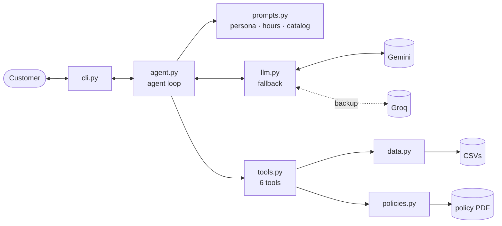

# 🎸 Clave — customer service agent for a musical instrument store

_[Leia em português](README.pt-BR.md)_

A conversational agent in Python that serves customers of a musical instrument store (the fictional **Empório da
Música**, in Campo Grande, Brazil). It looks up the catalog, prices, promotions, payment options and orders, applies
the store's policies, and hands off to the human team whatever requires action.

```
You:   Quanto custa o Takamine GD20?          (How much is the Takamine GD20?)
  ⚙ detalhes_produto({"produto": "Takamine GD20"})
  ⚙ calcular_pagamento({"produto_id": 95})
Clave: O Takamine GD20 Dreadnought Natural está disponível por R$ 2.199,00.
       No PIX sai por R$ 2.089,05 (5% off) ou em até 12x de R$ 183,25 sem juros. [...]
```

> **Language note:** the store and its customers are Brazilian, so the agent talks to customers in Portuguese,
> and the source data, tool names and example transcripts are in Portuguese as well. Documentation is in English.

**Highlights**

- **Function calling** over structured data (CSVs) and a PDF policy manual — the model decides *what* to look up; prices, installments and deadlines are computed in code.
- **Data protection:** order details are only shown when the owner's e-mail or phone number is provided.
- **Fallback across models and providers** (Gemini → Groq) to run on free tiers without interrupting the conversation.
- **Automated data quality checks**, which found 14 inconsistencies in the dataset.
- **29 tests** that run without calling the LLM.

---

## How to run

Requires Python 3.11+ and a free API key from [Google AI Studio](https://aistudio.google.com) (optional: a
[Groq](https://console.groq.com/keys) key as a backup provider).

```bash
git clone https://github.com/daianesmendes/emporio-agente.git
cd emporio-agente
cp .env.example .env      # paste the key into LLM_API_KEY (and optionally LLM_FALLBACK_API_KEY)
uv sync                   # or: python -m venv .venv && source .venv/bin/activate && pip install -e .
uv run emporio --debug
```

| Command | What it does |
|---|---|
| `emporio` | Chat in the terminal (`/novo` restarts, `/sair` exits) |
| `emporio --debug` | Shows which tools were called and which model answered |
| `emporio --sessao name` | Saves and resumes the conversation history |
| `emporio --roteiro file.txt -o out.md` | Runs a scripted conversation and saves the transcript |
| `pytest` | Runs the tests |

Other settings (models, backup provider, reference date) are documented in [`.env.example`](.env.example).

---

## Examples

Transcripts generated by running the agent (`emporio --roteiro`), showing the tools consulted for each answer:

1. [Acoustic guitars under R$ 1,000, a recommendation for a beginner, and installments](examples/01_catalogo_e_pagamento.md) — filtered search and context across messages
2. [Expired promotion and out-of-stock product](examples/02_promocao_expirada_e_esgotado.md) — transparency and alternatives
3. [Buyer's remorse that turns into a defect claim](examples/03_devolucao_lgpd_e_garantia.md) — identity check, deadlines, warranty and ticket number
4. [Store closed, accessories, saxophone, homework and "give me 50% off"](examples/04_informacoes_e_fora_do_escopo.md) — scope handling and a manipulation attempt
5. [Late delivery](examples/05_pedido_atrasado_reclamacao.md) — delay detection, empathy and hand-off

---

## Architecture



For each message, the agent builds the prompt, the LLM picks tools, Python runs them and returns the results, until
the final answer (at most 4 rounds).

| Tool | Purpose |
|---|---|
| `buscar_produtos` | Search by keyword, category and price range; tolerant to accents and plurals |
| `detalhes_produto` | Product details; suggests alternatives when out of stock or discontinued |
| `consultar_pedido` | Order status, tracking and return/warranty deadlines — requires the owner's contact |
| `calcular_pagamento` | PIX, debit, bank slip and installments according to the store's rules |
| `consultar_politicas` | Returns the requested section of the policy manual |
| `encaminhar_para_humano` | Opens or updates a case for the human team, with a ticket number |

---

## Technical decisions

**Tools instead of vector RAG or a SQL agent.** Structured data sits behind tools with fixed parameters: the LLM never
recalls a price or does math, and the privacy rule lives in code, not in the prompt. The manual (~11k characters,
10 sections) is served by section through an `enum` of topics — deterministic, with no risk of a chunk splitting a
table. With dozens of documents, I would move to hybrid search with reranking.

**No agent framework.** The loop is ~60 lines and keeps the round limit, history trimming and error handling visible.
LangGraph would make sense for long, stateful flows (e.g. completing a product exchange end to end).

**Provider-agnostic, with measured fallback.** The client uses the OpenAI-compatible API (Gemini, Groq, OpenAI,
Ollama). When a model returns 429, 503 or takes over 30 s, it is put on cooldown and the next one takes over; once
Gemini is exhausted, Groq takes over and receives only the standard message fields. The model order came from measurement,
not version numbers: the newest model was overloaded and took over 2 minutes, while the chosen one answers in ~4 s.

**Dynamic, lean prompt.** It is rebuilt on every message with the current time (store open or closed), a catalog
summary generated from the data, and the most requested information (address, hours, local shipping), so those
questions take a single call. Service procedures are read from the PDF itself, the single source of truth. The tone
follows the manual: informal but professional.

**Per-session history** persisted as JSON and trimmed to the most recent messages, without separating a tool call from
its result.

---

## Data quality

The original files stay untouched in `data/raw/`, and all cleaning happens in code. On load, the system checks for:

| Inconsistency | Handling |
|---|---|
| 6 products whose description names a different brand | The agent uses name, price and specs, without repeating the description |
| 3 categories with no products (woodwinds, brass, orchestral strings) | The agent says so, without inventing models |
| 2 orders whose total differs from the sum of their items | The total recorded on the order prevails |
| A "coming soon" product present in past orders | Logged as a catalog inconsistency |
| An active product with zero stock | Treated as out of stock, with alternatives |

The manual also contradicts itself (two phone numbers, conflicting installment rules, 30- vs 90-day warranty). Each
decision is documented in `CURATION_NOTES` ([`policies.py`](src/emporio/policies.py)) and delivered to the model along
with the manual section.

---

## Validation

Tests cover tools, business rules and the agent loop with a mocked LLM. The model's answers were also reviewed number
by number against the data, which revealed four hallucinations: an installment plan below the minimum, a requirement
that does not exist in the manual, an unsourced claim about a product, and an action stated without being executed.
Fixes were structural where possible — each product now carries its precomputed installment plan, and a tool can update
an open case. The affected conversations were regenerated.

---

## Assumptions, limitations and next steps

- **Reference date:** orders go up to March 2026, so the agent uses `AGENT_NOW=2026-03-25 14:00` for deadlines to make sense. Since the system has no delivery-received date, the estimated delivery date is used instead.
- **Limitations:** free-tier quotas and latency vary; search is keyword-based, not semantic; shipping to other cities
  is not calculated; cases are stored in a local file; and e-mail/phone verification is weak for production.
- **Next steps:** automated evaluation with a broad question set and LLM-as-judge; tracing (Langfuse or OpenTelemetry);
  an API with a WhatsApp webhook and OTP verification; Postgres instead of CSVs; semantic search over the catalog.

---

## Use of AI in development

Built with **Claude Code** as a pair programmer: initial data analysis, discussion of architecture decisions,
incremental implementation with tests, and review of the generated conversations. The decisions and final validation
were mine; the co-authored commits record this collaboration.

<sub>Project created as an AI Engineering technical challenge. Store and data are fictional.</sub>
