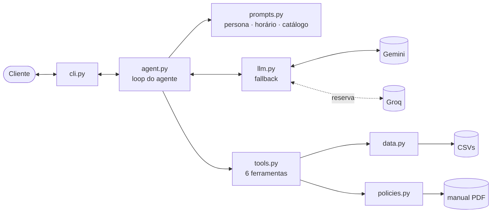

# 🎸 Clave — agente de atendimento para loja de instrumentos

_[Read in English](README.md)_

Agente conversacional em Python que atende clientes de uma loja de instrumentos musicais (a fictícia **Empório da
Música**): consulta catálogo, preços, promoções, pagamento e pedidos, aplica as políticas da loja e encaminha para a
equipe humana o que exige ação.

```
Você: Quanto custa o Takamine GD20?
  ⚙ detalhes_produto({"produto": "Takamine GD20"})
  ⚙ calcular_pagamento({"produto_id": 95})
Clave: O Takamine GD20 Dreadnought Natural está disponível por R$ 2.199,00.
       No PIX sai por R$ 2.089,05 (5% off) ou em até 12x de R$ 183,25 sem juros. [...]
```

**Destaques**

- **Function calling** sobre dados estruturados (CSVs) e um manual de políticas em PDF — o modelo decide *o que* consultar; preço, parcelas e prazos são calculados em código.
- **Proteção de dados:** pedidos só são exibidos com o e-mail ou telefone do dono.
- **Fallback entre modelos e provedores** (Gemini → Groq) para operar no plano gratuito sem interromper o atendimento.
- **Checagem automática de qualidade dos dados**, que encontrou 14 inconsistências na base.
- **29 testes** que rodam sem chamar o LLM.

---

## Como rodar

Requer Python 3.11+ e uma chave gratuita do [Google AI Studio](https://aistudio.google.com) (opcional: uma do
[Groq](https://console.groq.com/keys) como reserva).

```bash
git clone https://github.com/daianesmendes/emporio-agente.git
cd emporio-agente
cp .env.example .env      # cole a chave em LLM_API_KEY (e, se quiser, em LLM_FALLBACK_API_KEY)
uv sync                   # ou: python -m venv .venv && source .venv/bin/activate && pip install -e .
uv run emporio --debug
```

| Comando | O que faz |
|---|---|
| `emporio` | Conversa no terminal (`/novo` reinicia, `/sair` encerra) |
| `emporio --debug` | Mostra as ferramentas chamadas e o modelo que respondeu |
| `emporio --sessao nome` | Salva e retoma o histórico da conversa |
| `emporio --roteiro arquivo.txt -o saida.md` | Executa uma conversa roteirizada e grava a transcrição |
| `pytest` | Roda os testes |

As demais opções (modelos, provedor de reserva, data de referência) estão comentadas no [`.env.example`](.env.example).

---

## Exemplos

Transcrições geradas executando o agente (`emporio --roteiro`), com as ferramentas consultadas em cada resposta:

1. [Violões até R$ 1.000, indicação para iniciante e parcelamento](examples/01_catalogo_e_pagamento.md) — busca com filtros e contexto entre mensagens
2. [Promoção encerrada e produto esgotado](examples/02_promocao_expirada_e_esgotado.md) — transparência e alternativas
3. [Arrependimento de compra que vira defeito](examples/03_devolucao_lgpd_e_garantia.md) — verificação de identidade, prazos, garantia e protocolo
4. [Loja fechada, acessórios, saxofone, lição de casa e "me dá 50%"](examples/04_informacoes_e_fora_do_escopo.md) — escopo e tentativa de manipulação
5. [Pedido atrasado](examples/05_pedido_atrasado_reclamacao.md) — detecção de atraso, empatia e encaminhamento

---

## Arquitetura



A cada mensagem, o agente monta o prompt, o LLM escolhe ferramentas, o Python as executa e devolve o resultado, até a
resposta final (máximo de 4 rodadas).

| Ferramenta | Função |
|---|---|
| `buscar_produtos` | Busca por termo, categoria e faixa de preço, tolerante a acento e plural |
| `detalhes_produto` | Ficha do produto; sugere alternativas se estiver esgotado ou descontinuado |
| `consultar_pedido` | Status, rastreio e prazos de troca/garantia — exige o contato do dono |
| `calcular_pagamento` | PIX, débito, boleto e parcelamento conforme as regras da loja |
| `consultar_politicas` | Devolve a seção pedida do manual |
| `encaminhar_para_humano` | Abre ou complementa um caso para a equipe, com protocolo |

---

## Decisões técnicas

**Ferramentas em vez de RAG vetorial ou agente de SQL.** Dados estruturados ficam atrás de ferramentas com parâmetros
fechados: o LLM nunca lembra um preço nem faz conta, e a regra de privacidade fica no código, não no prompt. O manual
(~11 mil caracteres, 10 seções) é servido por seção via um `enum` de tópicos — determinístico e sem risco de um chunk
cortar uma tabela. Com dezenas de documentos, eu passaria para busca híbrida com reranking.

**Sem framework de agentes.** O loop tem ~60 linhas e deixa visíveis o teto de rodadas, o corte de histórico e o
tratamento de erro. LangGraph faria sentido com fluxos longos e com estado (ex.: concluir uma troca de ponta a ponta).

**Agnóstico de provedor, com fallback medido.** O cliente usa a API compatível com OpenAI (Gemini, Groq, OpenAI, Ollama).
Quando um modelo devolve 429, 503 ou passa de 30 s, ele entra em espera e o próximo assume; esgotado o Gemini, entra o
Groq, recebendo só os campos padrão do histórico. A ordem dos modelos veio de medição, não do número da versão: o mais
novo estava sobrecarregado e levava mais de 2 min, enquanto o escolhido responde em ~4 s.

**Prompt dinâmico e enxuto.** É reconstruído a cada mensagem com a hora atual (loja aberta ou fechada), um resumo do
catálogo gerado dos dados e as informações mais pedidas (endereço, horário, frete local), que assim saem com uma
chamada só. Os procedimentos de atendimento são lidos do próprio PDF, que é a fonte única. Tom definido pelo manual: informal, mas profissional.

**Histórico persistido por sessão** em JSON e cortado nas mensagens mais recentes, sem separar uma chamada de
ferramenta do seu resultado.

---

## Qualidade dos dados

Os arquivos originais ficam intactos em `data/raw/` e a limpeza é feita em código. Ao carregar, o sistema verifica:

| Inconsistência | Tratamento |
|---|---|
| 6 produtos cuja descrição cita outra marca | O agente usa nome, preço e especificações, sem repetir a descrição |
| 3 categorias sem produto (sopro, cordas orquestrais) | O agente informa que não há, sem inventar modelos |
| 2 pedidos com total diferente da soma dos itens | Vale o total registrado no pedido |
| Produto "em breve" presente em pedidos já feitos | Registrado como inconsistência do cadastro |
| Produto ativo com estoque zero | Tratado como esgotado, com alternativas |

O manual também tem contradições (dois telefones, regras de parcelamento divergentes, garantia de 30 × 90 dias). Cada
decisão está documentada em `CURATION_NOTES` ([`policies.py`](src/emporio/policies.py)) e é entregue ao modelo junto
com a seção do manual.

---

## Validação

Os testes cobrem ferramentas, regras e o loop do agente com um LLM simulado. As respostas do modelo foram revisadas
número a número contra os dados, e isso revelou quatro alucinações: um parcelamento abaixo da parcela mínima, uma
exigência inexistente no manual, um elogio sem fonte e uma ação declarada sem ter sido executada. As correções foram,
de preferência, estruturais: cada produto já traz o parcelamento calculado, e há uma ferramenta para complementar um caso
aberto. As conversas afetadas foram regeradas.

---

## Suposições, limitações e próximos passos

- **Data de referência:** os pedidos vão até março de 2026, então o agente usa `AGENT_NOW=2026-03-25 14:00` para os prazos fazerem sentido. Como não existe data de recebimento no sistema, a previsão de entrega serve de referência.
- **Limitações:** a cota e a latência do plano gratuito variam; a busca é por palavra-chave, não semântica; o frete
  para outras cidades não é calculado; os casos ficam num arquivo local; e a verificação por e-mail ou telefone é fraca para produção.
- **Próximos passos:** avaliação automatizada com um conjunto amplo de perguntas e LLM-as-judge; tracing (Langfuse ou
  OpenTelemetry); API com webhook de WhatsApp e verificação por OTP; Postgres no lugar dos CSVs; busca semântica no catálogo.

---

## Uso de IA no desenvolvimento

Desenvolvido com o **Claude Code** como par de programação: análise inicial dos dados, discussão das decisões de
arquitetura, implementação incremental com testes e revisão das conversas geradas. As decisões e a validação final
foram minhas; os commits coassinados registram essa colaboração.

<sub>Projeto criado como desafio técnico de AI Engineering. Dados e loja fictícios.</sub>
